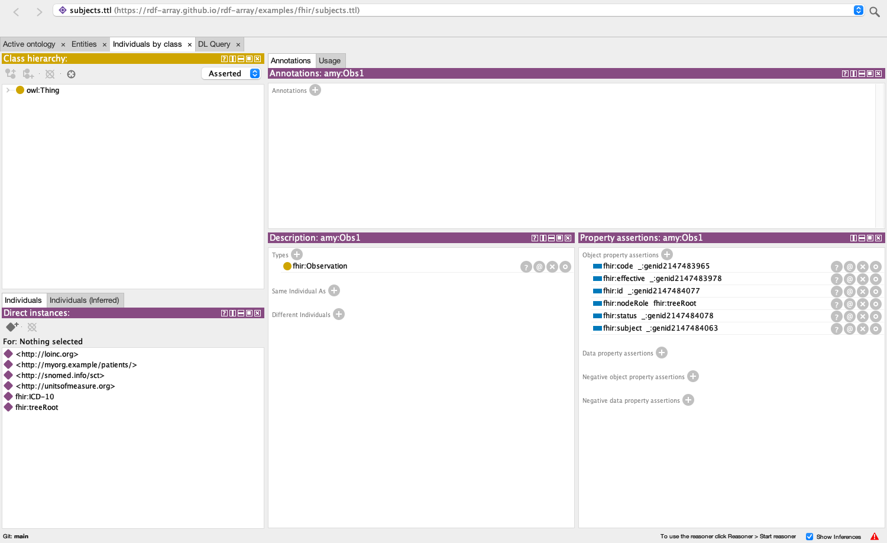
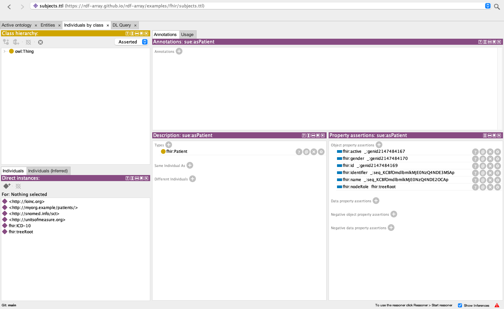
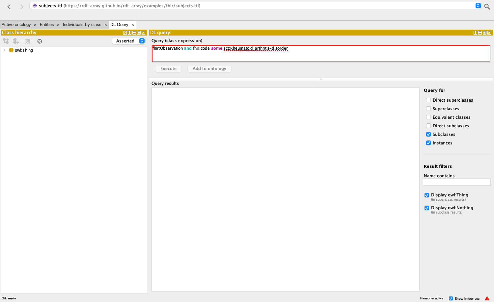
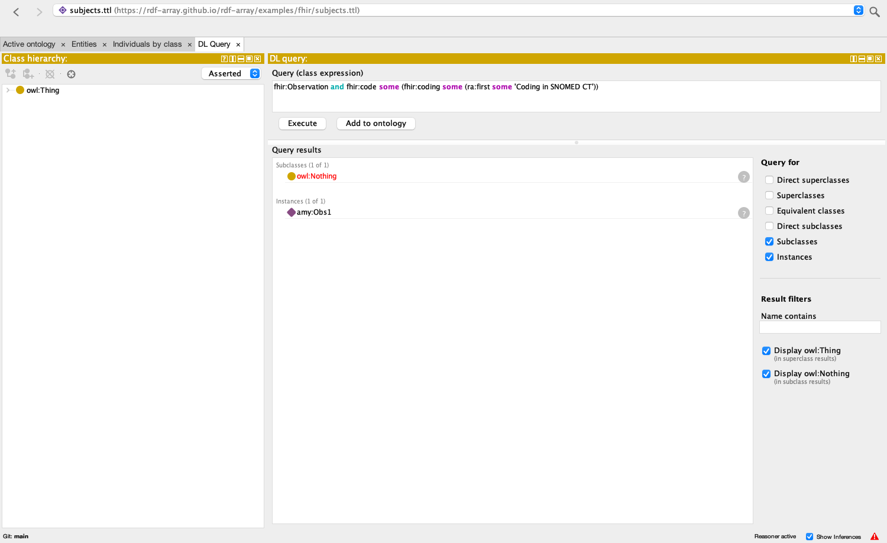
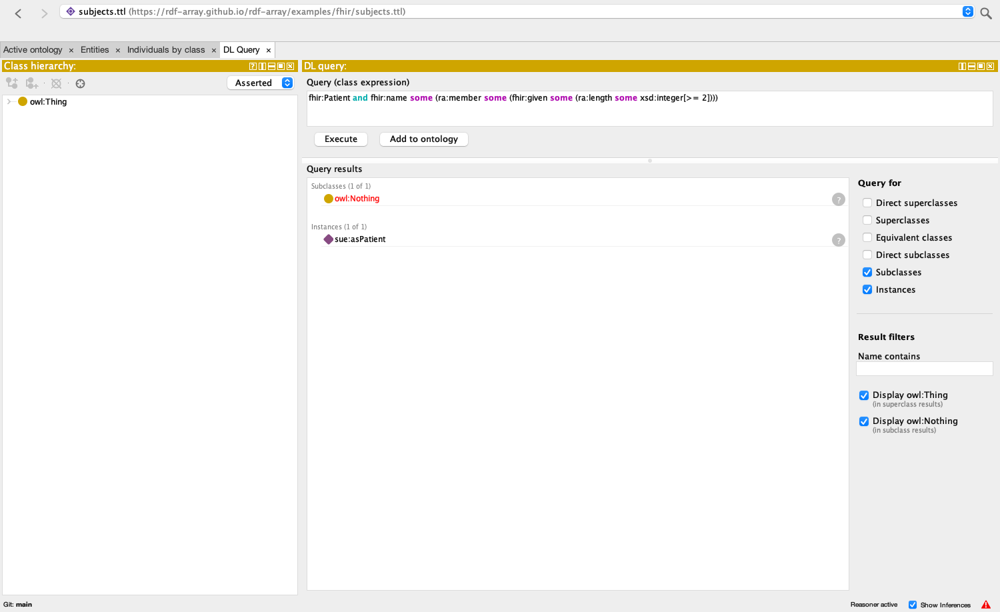

# FHIR RDF reasoning with OWL-array

*Example, 2026-10-27. The process of [Semantic Representations of Clinical Care Data Leveraging HL7
FHIR](https://www.w3.org/2016/Talks/1205-swat4ls-egp/reasoning.html) (Solbrig and Prud'hommeaux, SWAT4LS,
4 December 2016) over the FHIR RDF of today, which writes a repeated element as a list, with
[OWL-array](../../docs/owl-array.html) to look into the list. Run through
[owlapi-array](https://github.com/rdf-array/owlapi-array) and HermiT (every query below answers as
expected), and in Protégé 5.6.9 with owlapi-array's bundle and the
[protege-owl-array](https://github.com/rdf-array/protege-owl-array) reasoner plugin, whose DL Query tab
lists the same answers (§4). The sources are
[examples/fhir](https://github.com/rdf-array/rdf-array/tree/main/examples/fhir) in the rdf-array
meta-repository.*

The 2016 talk classified FHIR observations by what they are observations of: define a class of codings
by system and code, connect it to a SNOMED CT concept, and let SNOMED CT's hierarchy answer "which
observations are of an arthritis?". FHIR RDF has changed since: an element's literal is `fhir:v`, a uri
also carries `fhir:l`, the IRI, a repeated element such as `CodeableConcept.coding` is an RDF list
`( … )`, and a CodeableConcept may carry the concept IRIs of its codings as `rdf:type` arcs. The list
is the problem for OWL: FHIR's own [RDF page](https://build.fhir.org/rdf.html) warns that RDF lists
"cause problems for OWL 2" and offers a conversion script. Read over rdf-array the list is one term,
and OWL-array gives a class expression a way into it, `fhir:coding some (ra:member some C)`, so the
2016 process runs on today's data unchanged in spirit: recognizers over the codings in the list,
connective tissue to SNOMED CT, DL queries over the hierarchy.

## 1. The files

| File | What it is |
|---|---|
| [`subjects.ttl`](subjects.ttl) | the root: imports the three subjects. Open this one. |
| [`subject-amy.ttl`](subject-amy.ttl), [`subject-bob.ttl`](subject-bob.ttl), [`subject-sue.ttl`](subject-sue.ttl) | a Patient and an Observation each, in today's FHIR RDF. Amy: rheumatoid arthritis coded in SNOMED CT then ICD-10, with the SNOMED CT concept IRI the generator adds, and a blood pressure of 150/95 with two components. Bob: seronegative rheumatoid arthritis, ICD-10 first and SNOMED CT second, no concept IRI. Sue: seropositive rheumatoid arthritis in ICD-10 only. |
| [`arthritis.ttl`](arthritis.ttl) | the talk's domain logic: recognizers of codings, connective tissue through the coding list to SNOMED CT concepts, the classes the DL queries ask for, and two more that look at the list itself. |
| [`blood-pressure.ttl`](blood-pressure.ttl) | a second domain, after FHIR's [compound blood pressure example](https://build.fhir.org/observation-example-compound-numeric-blood-pressure.ttl): components are a list, each with a coding list of its own, and a number to compare. |
| [`fhir-min.ttl`](fhir-min.ttl) | the part of the FHIR ontology ([fhir.ttl](https://build.fhir.org/fhir.ttl)) the subjects use, with each repeating element typed as a sequence of its element type. Imports the [OWL-array vocabulary](../../vocab/owl-array.ttl). |
| `snomedct_extract_descriptive.ttl`, `snomedct_extract_base_descriptive.ttl` | the SNOMED CT extract of the 2016 talk, unchanged: arthritis and its neighbourhood, with descriptive IRIs (`sct:Rheumatoid_arthritis-disorder`) and the numeric code as an annotation. |
| [`catalog-v001.xml`](catalog-v001.xml) | maps every `owl:imports` IRI to the file beside it, in the form Protégé reads. |
| [`FhirReasoning.java`](FhirReasoning.java), [`pom.xml`](pom.xml) | the check: loads `subjects.ttl` through the catalog, reasons with HermiT behind owlapi-array's decorator, runs the DL queries of §3 and compares the answers (§5). |

The ontology IRIs are the files' addresses on this site, so the imports resolve on the web as well as
through the catalog; the SNOMED CT ones are the module IRIs the 2016 extract carries and resolve only
through the catalog.

## 2. What changed since 2016, in the data

| 2016 (FHIR STU3 RDF) | Today |
|---|---|
| `fhir:Observation.code`, `fhir:CodeableConcept.coding`, `fhir:Coding.system`: a property per element of each type | `fhir:code`, `fhir:coding`, `fhir:system`: one property per element name, reused across types |
| `fhir:Coding.system [ fhir:value "http://snomed.info/sct" ]`: a string | `fhir:system [ fhir:v "http://snomed.info/sct"^^xsd:anyURI ; fhir:l <http://snomed.info/sct> ]`: a typed literal and an IRI |
| one coding, a blank node | `fhir:coding ( [ … ] [ … ] )`: a list of codings, in order |
| the talk's own `fhir:concept` link from a coding to a SNOMED CT concept | `fhir:code [ a sct:69896004 ; fhir:coding ( … ) ]`: the generator types the CodeableConcept with the concept IRI when the code system has an IRI stem |
| `fhir:Observation.code some (fhir:CodeableConcept.coding some (fhir:concept some sct:Rheumatoid_arthritis-disorder))` | `fhir:code some sct:Rheumatoid_arthritis-disorder`, with `ra:member` doing the work of reaching the codings (§3) |

Amy's observation, today:

```turtle
amy:Obs1 a fhir:Observation ;
  fhir:status [ fhir:v "final" ] ;
  fhir:code [
     a sct:69896004 ;
     fhir:coding ( [
       fhir:system [ fhir:v "http://snomed.info/sct"^^xsd:anyURI ; fhir:l <http://snomed.info/sct> ] ;
       fhir:code [ fhir:v "69896004" ] ;
       fhir:display [ fhir:v "Rheumatoid arthritis" ]
     ] [
       fhir:system [ fhir:v "http://hl7.org/fhir/sid/icd-10"^^xsd:anyURI ; fhir:l <http://hl7.org/fhir/sid/icd-10> ] ;
       fhir:code [ fhir:v "M06.9" ] ;
       fhir:display [ fhir:v "Rheumatoid arthritis, unspecified" ]
     ] ) ;
     fhir:text [ fhir:v "Rheumatoid arthritis" ]
  ] ;
  fhir:subject [ fhir:reference [ fhir:v "Patient/amy" ] ; fhir:l amy:asPatient ] ;
  fhir:effective [ a fhir:DateTime ; fhir:v "2016-12-01T10:00:00Z"^^xsd:dateTime ] .
```

## 3. The process, step by step

The steps of the talk, as `arthritis.ttl` writes them; each `##` comment there has the Manchester
syntax that Protégé's DL Query tab takes.

1. **A predicate ontology.** `fhir-min.ttl` declares the classes and properties, in fhir.ttl's style
   but with every repeating element a list: `fhir:CodeableConcept SubClassOf: fhir:coding only
   (ra:Sequence and ra:member only fhir:Coding)`, `fhir:coding max 1`. From that alone a reasoner knows
   that each blank node in a coding list is a `fhir:Coding`.
2. **Recognizers.** A coding is recognised by its system and its code: `:Coding-of-sct-69896004
   EquivalentTo: fhir:system some (fhir:l value <http://snomed.info/sct>) and fhir:code some (fhir:v
   value "69896004")`. The system is an individual now (`fhir:l`); the code is still a literal, so this
   is the one place a class is defined from a string, as in 2016 ("we can't reason about literals so we
   make classes for each code"). One recognizer per code, in SNOMED CT and in ICD-10.
3. **Connective tissue, through the list.** `fhir:coding some (ra:member some (:Coding-of-sct-69896004
   or :Coding-of-icd10-M06.9)) SubClassOf: sct:69896004`: a CodeableConcept one of whose codings is a
   recognised rheumatoid arthritis coding is an instance of the SNOMED CT concept, which is exactly the
   type arc FHIR's generator adds when it can. So Amy's CodeableConcept is `sct:69896004` twice over,
   Bob's from the SNOMED CT coding in second position, Sue's from an ICD-10 code mapped to SNOMED CT.
   `sct:69896004 EquivalentTo: sct:Rheumatoid_arthritis-disorder` joins the numeric IRIs of FHIR RDF
   and SNOMED CT's own OWL to the 2016 extract's descriptive ones.
4. **SNOMED CT's hierarchy.** The talk's queries: an observation of rheumatoid arthritis, of
   seronegative rheumatoid arthritis, of an arthritis (by subclass), of an inflammatory disorder with
   a musculoskeletal finding site (by the role-group definitions in the extract).
5. **Beyond the talk.** The patient, through the Reference (`fhir:subject [ fhir:l amy:asPatient ]`):
   `fhir:Patient and inverse fhir:l some (inverse fhir:subject some :Observation-of-Rheumatoid_arthritis)`.
   The shape of the list itself: whose primary coding is SNOMED CT (`ra:first`), which are coded in more
   than one system (`ra:length`). And in `blood-pressure.ttl`, a component list inside an observation,
   each component with its own coding list and a Quantity: `fhir:component some (ra:member some
   (bp:Systolic-component and fhir:value some (fhir:value some (fhir:v some xsd:decimal[>= 140]))))`.

## 4. In Protégé

Done on 2026-10-27, in Protégé 5.6.9 (the platform-independent zip, Java 21 on macOS) with two
changes and nothing else: `bundles/owlapi-osgidistribution.jar` replaced by owlapi-array's bundle (same
symbolic name, `org.semanticweb.owl.owlapi`, and version, 4.5.29) and
[protege-owl-array](https://github.com/rdf-array/protege-owl-array)'s plugin added to `plugins/`. Its
`assemble.sh` builds that from the stock zip. The walk-through was driven from inside Protégé by that
repository's `walkthrough` bundle, which uses Protégé's own model, reasoner menu and DL Query view and
paints the window to the PNGs below; its log is [`protege/walkthrough.txt`](protege/walkthrough.txt). [OWL-array in Protégé](../../docs/protege-array.html) is the same walk-through as a demo, step by step, with
the inferred types of the observations and patients as Protégé shows them.

**1. Open `subjects.ttl`.** The catalog resolves the nine imports; the closure is 10 ontologies and
1171 axioms, no triple is left unparsed in any of them, no `rdf:first` is anywhere in a signature,
and the 16 lists are 16 sequence terms. amy:Obs1 shows `fhir:code` to a blank node, as in 2016:



A sequence displays by its node ID: sue:asPatient's `fhir:identifier` and `fhir:name` are
`_:seq_KCBf…`, the base64url of `( _:genid… )`, until owlapi-array's Manchester renderer, which
Protégé's own renderer extends, learns `( … )`:



**2. Reasoner menu.** It lists "HermiT 1.4.3 (OWL-array)" and "ELK 0.6.0 (OWL-array)" beside the stock
HermiT and ELK. With the OWL-array HermiT the closure is consistent and the reasoner starts in two
and a half seconds.

**3. DL Query tab.** Protégé names an entity by its `rdfs:label` when it has one, prefixed, and the
query editor parses only the names it displays. `sct:Rheumatoid_arthritis-disorder`, as §5 spells
it, is underlined and Execute stays disabled; the same class is `'sct:Rheumatoid arthritis
(disorder)'` there:



Typed as Protégé displays the names, every query of §5 lists the instances `FhirReasoning.java`
finds, 24 of 24 (with Instances ticked):

| # | Typed in the DL Query tab | Instances listed |
|---|---|---|
| 01 | `fhir:Observation and fhir:code some 'sct:Rheumatoid arthritis (disorder)'` | amy:Obs1 bob:Obs1 sue:Obs1 |
| 02 | `fhir:Observation and fhir:code some 'sct:Rheumatoid arthritis (disorder)'` | amy:Obs1 bob:Obs1 sue:Obs1 |
| 03 | `'Observation of Rheumatoid arthritis'` | amy:Obs1 bob:Obs1 sue:Obs1 |
| 04 | `'Observation of Seronegative rheumatoid arthritis'` | bob:Obs1 |
| 05 | `'Observation of Seropositive rheumatoid arthritis'` | sue:Obs1 |
| 06 | `fhir:Observation and fhir:code some 'sct:Arthritis (disorder)'` | amy:Obs1 bob:Obs1 sue:Obs1 |
| 07 | `'Observation of an inflammatory disorder with a musculoskeletal finding site'` | amy:Obs1 bob:Obs1 sue:Obs1 |
| 08 | `fhir:Observation and fhir:code some ('sct:Inflammatory disorder (disorder)' and 'sct:Role group (attribute)' some ('sct:Associated morphology (attribute)' some 'sct:Inflammatory morphology (morphologic abnormality)' and 'sct:Finding site (attribute)' some 'sct:Structure of musculoskeletal system (body structure)'))` | amy:Obs1 bob:Obs1 sue:Obs1 |
| 09 | `fhir:Observation and fhir:code some (fhir:coding some (ra:member some 'Coding in ICD-10'))` | amy:Obs1 bob:Obs1 sue:Obs1 |
| 10 | `fhir:Observation and fhir:code some (fhir:coding some (ra:member some 'Coding: ICD-10 M05.9, Seropositive rheumatoid arthritis, unspecified'))` | sue:Obs1 |
| 11 | `'Patient with an observation of rheumatoid arthritis'` | amy:asPatient bob:asPatient sue:asPatient |
| 12 | `fhir:Patient and inverse fhir:l some (inverse fhir:subject some 'Observation of Seronegative rheumatoid arthritis')` | bob:asPatient |
| 13 | `'Observation whose primary coding is SNOMED CT'` | amy:Obs1 |
| 14 | `fhir:Observation and fhir:code some (fhir:coding some (ra:first some 'Coding in SNOMED CT'))` | amy:Obs1 |
| 15 | `fhir:Observation and fhir:code some (fhir:coding some (ra:last some 'Coding in SNOMED CT'))` | amy:Obs2 bob:Obs1 |
| 16 | `'Observation coded in more than one system'` | amy:Obs1 amy:Obs2 bob:Obs1 |
| 17 | `fhir:Observation and fhir:code some (fhir:coding some (ra:length value 1))` | sue:Obs1 |
| 18 | `'bp:Observation of blood pressure'` | amy:Obs2 |
| 19 | `'bp:Observation of blood pressure with a systolic reading of 140 mm[Hg] or more'` | amy:Obs2 |
| 20 | `'bp:Observation of blood pressure with exactly two components'` | amy:Obs2 |
| 21 | `'bp:Observation of blood pressure with a systolic and a diastolic component'` | amy:Obs2 |
| 22 | `fhir:Observation and fhir:component some (ra:member some (fhir:value some (fhir:value some (fhir:v some xsd:decimal[>= 160]))))` | (none) |
| 23 | `fhir:Patient and fhir:name some (ra:member some (fhir:given some (ra:length some xsd:integer[>= 2])))` | sue:asPatient |
| 24 | `fhir:Observation and fhir:code some (fhir:coding some ra:EmptySequence)` | (none) |





The Observation and Patient individuals are IRIs and appear; the CodeableConcepts, codings and
lists are blank nodes and sequences and do not ([rdf-array#21](https://github.com/rdf-array/rdf-array/issues/21)).

**4. ELK (OWL-array)**, the closure left out, lists none of the 22 non-empty answers: ELK skips
anonymous individuals ("Potential incompleteness due to occurrences of AnonymousIndividual", 213 of
them), and every FHIR element is one. Naming them inside the expansion
([rdf-array#20](https://github.com/rdf-array/rdf-array/issues/20)) would give ELK the data as well.

**5. Saving.** arthritis.ttl (with its `owl:unionOf` lists) and subject-sue.ttl (lists of blank nodes,
one inside another) save as Turtle and as RDF/XML and read back with the same axioms, besides the
`owl:NamedIndividual` declarations the writers add. An ontology loaded from Turtle is saved as
Turtle. RDF/XML refuses a list holding a literal
([rdf-array#18](https://github.com/rdf-array/rdf-array/issues/18)); this data has none, since every
FHIR element, a given name included, is a node.

The walk-through found two things, both fixed: `subjects.ttl` now declares the default prefix as
arthritis.ttl's namespace, without which Protégé gave the `:` prefix to subjects.ttl itself and showed
arthritis.ttl's classes as full IRIs, which the query editor does not parse; and owlapi-array's RDF
writers dropped the triples of a blank node inside a sequence (sue's given names), now written inside
the list.

## 5. The queries and their answers

`FhirReasoning.java` runs these through owlapi-array and HermiT 1.4.5 (the OWL API 4 build): the
closure loads in a quarter of a second (10 ontologies, 1171 axioms, 16 sequences, no `rdf:first`
anywhere), is consistent, and classifies in half a second. Every answer is as expected.

| DL query | Instances |
|---|---|
| `fhir:Observation and fhir:code some sct:Rheumatoid_arthritis-disorder` | amy:Obs1, bob:Obs1, sue:Obs1 |
| `fhir:Observation and fhir:code some sct:69896004` | the same |
| `:Observation-of-Seronegative_rheumatoid_arthritis` | bob:Obs1 |
| `:Observation-of-Seropositive_rheumatoid_arthritis` | sue:Obs1 |
| `fhir:Observation and fhir:code some sct:Arthritis-disorder` | amy:Obs1, bob:Obs1, sue:Obs1 |
| `fhir:Observation and fhir:code some (sct:Inflammatory_disorder-disorder and sct:role_group-attr some (sct:Associated_morphology-attr some sct:Inflammatory_morphology-morph and sct:Finding_site-attr some sct:Structure_of_musculoskeletal_system-body))` | amy:Obs1, bob:Obs1, sue:Obs1 |
| `fhir:Observation and fhir:code some (fhir:coding some (ra:member some :Coding-in-ICD-10))` | amy:Obs1, bob:Obs1, sue:Obs1 |
| `fhir:Observation and fhir:code some (fhir:coding some (ra:member some :Coding-of-icd10-M05.9))` | sue:Obs1 |
| `:Patient_with_rheumatoid_arthritis` | amy:asPatient, bob:asPatient, sue:asPatient |
| `fhir:Patient and inverse fhir:l some (inverse fhir:subject some :Observation-of-Seronegative_rheumatoid_arthritis)` | bob:asPatient |
| `fhir:Observation and fhir:code some (fhir:coding some (ra:first some :Coding-in-SNOMED))` | amy:Obs1 |
| `fhir:Observation and fhir:code some (fhir:coding some (ra:last some :Coding-in-SNOMED))` | amy:Obs2, bob:Obs1 |
| `fhir:Observation and fhir:code some (fhir:coding some (ra:length some xsd:integer[>= 2]))` | amy:Obs1, amy:Obs2, bob:Obs1 |
| `fhir:Observation and fhir:code some (fhir:coding some (ra:length value 1))` | sue:Obs1 |
| `bp:Observation-of-elevated-blood-pressure` | amy:Obs2 |
| `bp:Two-component-blood-pressure`, `bp:Complete-blood-pressure` | amy:Obs2 |
| `fhir:Observation and fhir:component some (ra:member some (fhir:value some (fhir:value some (fhir:v some xsd:decimal[>= 160]))))` | none |
| `fhir:Patient and fhir:name some (ra:member some (fhir:given some (ra:length some xsd:integer[>= 2])))` | sue:asPatient |
| `fhir:Observation and fhir:code some (fhir:coding some ra:EmptySequence)` | none |

And the axiom fhir.ttl publishes for the repeating element, `fhir:CodeableConcept SubClassOf:
fhir:coding only fhir:Coding`, added to the closure makes it inconsistent: the value of `fhir:coding` is
the list, `fhir-min.ttl` says a list is no FHIR element (`fhir:Base DisjointWith: ra:Sequence`), and the
contradiction is the point. Over rdf-array the FHIR ontology has to say `ra:member only`; its generator,
kindling's `FhirTurtleGenerator`, is a target in [repos.html](../../repos.html#not-yet-forked).

To run the check against owlapi-array's jars (built with `mvn install -Dmaven.repo.local=…`, as its
`doc/rdf-array.md` says), from this directory:

```bash
mvn -q -Dmaven.repo.local=/path/to/.m2-owlapi dependency:build-classpath -Dmdep.outputFile=cp.txt
javac -d out -cp "$(cat cp.txt)" FhirReasoning.java
java -cp "out:$(cat cp.txt)" FhirReasoning .
```

## 6. Findings

- **`xsd:date` stops HermiT.** FHIR writes a `date` as `xsd:date` (and `gYear`, `gYearMonth`,
  `time`), none of which is in the OWL 2 datatype map, and HermiT refuses to load a literal of a
  datatype it does not know. The subjects therefore carry no `fhir:birthDate`. Real FHIR data will;
  a FHIR-to-OWL pipeline needs a reasoner with those datatypes, a custom datatype definition, or a
  rewrite of such literals before reasoning. Nothing to do with lists, but it will be the first thing
  Protégé users hit.
- **Every FHIR list holds blank nodes**, since every element is one, so no list here gets the object
  closure of owl-array.md §6, which OWL 2 DL allows only over named individuals
  ([rdf-array#20](https://github.com/rdf-array/rdf-array/issues/20)). `some` over members is
  unaffected, and `only` over members holds where an axiom gives it (every coding is a Coding), but a
  DL query that asks it of the data, "observations all of whose codings are ICD-10", finds nothing where
  it should find sue:Obs1. Worse, HermiT reads a class assertion on an anonymous individual
  existentially, so `getSequenceInstances(fhir:Observation)` returned all 16 lists and `isEntailed` of a
  class assertion on such a list answers for some individual, not this one. owlapi-array's
  `getSequenceInstances` now leaves those lists out, so it returns none of the 16 until #20 is decided;
  `isEntailed` still answers existentially for them. Naming the expansion
  individuals and the blank nodes inside them, inside the reasoner's view only, would settle both;
  that is the recommendation recorded on #20.
- **JFact 4.0.4 calls the closure inconsistent** where HermiT finds it consistent; the verdict goes
  away when the data property assertions or the cardinality restrictions are removed, so it is JFact's
  datatype reasoning over `fhir:v exactly 1` with literals of several datatypes. HermiT is the
  reference here, and the one Protégé bundles.
- **The FHIR ontology's list axioms are wrong over rdf-array**, as §5 shows: `allValuesFrom` on a
  repeating element types the list. The fix is mechanical, `ra:member only` for every element whose
  maximum cardinality is `*`, and belongs in the generator.
